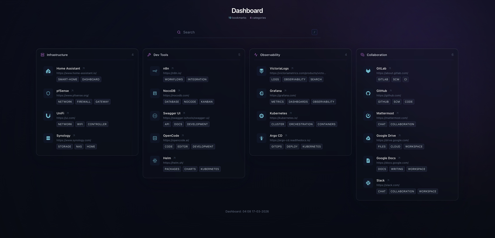

# Static Dashboard Builder

I made this because most bookmark dashboard repositories haven't really moved in years, and many of them are more complicated than they need to be.

This project is a **static bookmark dashboard generator**. You keep a simple `dashboard.yml`, run one Python script, and it creates a single `index.html` page.

No backend. No database. No app server. Just a generated page.



## How it works

- `dashboard.yml` contains your categories, links, icons, and tags
- `generate.py` reads that YAML and creates `index.html`
- icons are referenced with Iconify names in `dashboard.yml`
- the generated page uses Alpine.js, Tailwind, and Iconify from CDNs at runtime

## Usage

Requirements:
- Python 3
- PyYAML

Generate the dashboard:

```bash
pip install pyyaml
python3 generate.py --source dashboard.yml --output index.html
```

Or, if you prefer user installs:

```bash
python3 -m pip install --user pyyaml
python3 generate.py --source dashboard.yml --output index.html
```


```bash
python3 generate.py --source dashboard.yml --output index.html
```

## Editing the dashboard

Update `dashboard.yml` however you want.

Honestly, the easiest workflow is to use an LLM to help maintain `dashboard.yml` — add links, retag things, reorganize categories, and keep the structure clean.

## Tip

You can use the generated page locally as your default browser start page, or host it anywhere as a tiny static site.

A nice workflow is to use a CI pipeline to regenerate the dashboard on every `dashboard.yml` update and publish the resulting `index.html` behind a very simple web server.

## Files

- `generate.py` — static page generator
- `dashboard.yml` — your bookmark data
- `index.html` — generated output
- `example.html` — example generated page for the repository
- `example-dashboard.jpg` — screenshot example of the generated dashboard

The included `dashboard.yml` uses only public example URLs so nothing personal is exposed.

## License

Licensed under the [Apache License, Version 2.0](./LICENSE).
You can use, modify, and redistribute this project for free, including for commercial use,
subject to the license terms. When redistributing, include the license and preserve
applicable copyright and attribution notices, including [NOTICE](./NOTICE).

A credit and link back to [Static Dashboard Builder](https://github.com/mina-ai-assistant/static-dashboard)
are appreciated, but a visible backlink is not required by the license.

Third-party libraries and icons remain subject to their own licenses.
